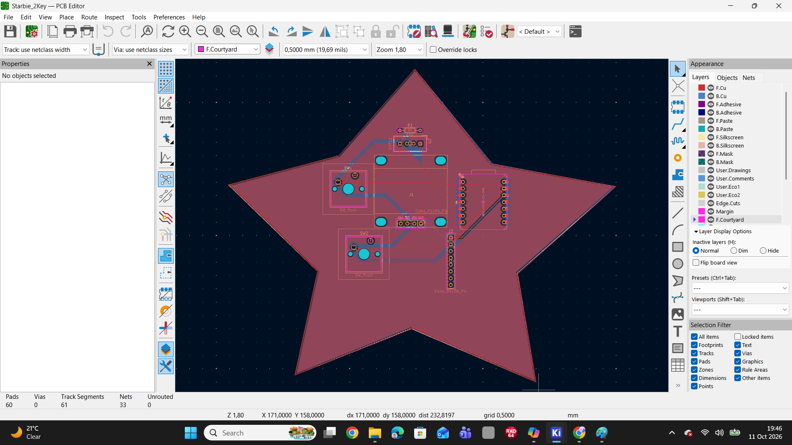

# Starbie 2-Key Project

This is my first Hack Club hardware project made with KiCad.  
It’s a star-shaped PCB with two push buttons and connectors.  
The board is designed for simple input control and learning PCB design.

## Features
- Star-shaped PCB design
- Two push buttons
- Connector pins for external components

## Tools Used
- KiCad for PCB design
- Hack Club Half Life for project guidance

## Images
## Project Images

## Bill of Materials
See [bom.csv](bom.csv) for the list of components.

